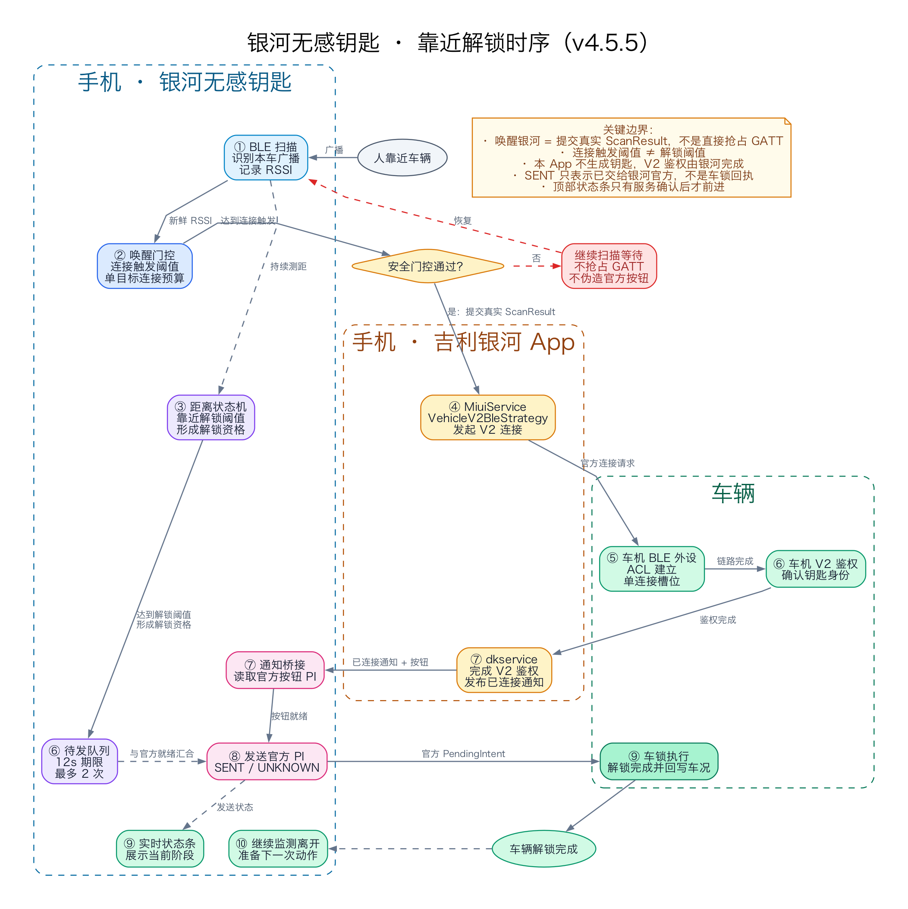

# 银河无感钥匙 · GeelyPassiveKey

把吉利银河的「靠近解锁 / 远离上锁」重做一遍：**手机自己判断你在靠近还是离开，然后替你把银河 App 的蓝牙钥匙连上、把锁打开。**

车机里那个「无感进出」开关可以一直关着，本 App 不依赖它。

[⬇️ 下载 APK](https://github.com/yangyongyongyong/GeelyPassiveKey/releases/latest) · [v4.0 设计说明](docs/36_minimal_generic_passive_key.md) · [逆向知识库](docs/)

[](docs/68_unlock_sequence_and_architecture.md)

> 一张图看懂：扫描本车 → 连接触发 → 银河鉴权 → 靠近解锁 → 离开确认上锁。连接触发阈值不等于靠近解锁阈值。

当前源码版本为 **v4.6.13-min（构建 613）**：基于 v4.6.9 的 6 份用户日志完成加固。扫描回调停滞窗口收紧为后台 10 秒、亮屏 4 秒，并支持亮屏/解锁强制重建扫描器；扫描错误码 2/3/5 直接硬恢复；亮屏时会在安全门控下补拉一次银河连接；通知监听重绑改为有界退避；RSSI 深谷回流只有在 90 秒内存在明确 `LOCKED` 锁态时才允许第二次解锁。v4.6.9 的防重复上锁、无通知 GATT 学习和官方通知当前按钮优先继续保留。默认参数保持连接 `≥ -95 dBm`、靠近解锁 `≥ -75 dBm`、离开上锁 `≤ -85 dBm`、离开确认 `2.0 秒`，升级不会覆盖用户配置。v4.6.13 针对周围车辆密集易丢主动 `SCAN_RSP` 的场景，放宽同厂商同尾号纯被动 `0x01FE` 提前唤醒门槛（首包 `-76 dBm` / 连收 3 包 `-83 dBm`），将 `ACL_CONNECTED` 后的旁路 GATT 观察延迟 1.5 秒以避让官方 V2 鉴权，并把离车零回调巡检退避至 180 秒。v4.6.12 修复离车期间 BLE 扫描看门狗 10 秒过频重启触发系统限频、导致亮屏后出现 ~6.4 秒空白的问题（后台放宽至 30 秒并支持零回调 60 秒退避，亮屏不打断 8 秒内新鲜扫描）。v4.6.11 在此基础上修复 Android 17 官方小组件 `updateAppWidget` 捕获与动态资源 ID 解析、兼容抓包期间误切过滤、星愿 `GeelyAuto`/`Geely_Auto` 双拼写硬件放行、鸿蒙跨容器未安装银河时唤醒循环及通知监听交互恢复冷却。详见 [v4.6.11小组件与星愿兼容修复](docs/85_v4_6_11_widget_starwish_and_container_fixes.md)、[v4.6.10上报加固](docs/84_v4_6_10_feedback_hardening_and_avd.md)、[v4.6.9重复上锁与无通知GATT](docs/83_v4_6_9_duplicate_lock_and_notificationless_gatt.md) 与 [v4.6.8日志修复](docs/82_20261122_scan_health_and_geely_159_notification.md)。

当前源码 `v4.6.13-min` 继续使用稳定签名证书 `279948c5d7401188fb72c218e954fc088b8d9cd5eb1aece6dd077b19c08145c4`。本地构建继续使用稳定密钥；正式发布后仍由 Actions 自动预热、校验 Cloudflare 更新镜像。升级保留用户已保存配置。v4.2.2 的单 MiuiService、15 秒通知补扫、GATT `cmdId=5` 提前就绪与 PendingIntent 回退继续保留，详见 [v4.2.2说明](docs/58_v4_2_2_long_absence_weak_connect.md)、[v4.2.1说明](docs/57_v4_2_1_lockscreen_fast_rescan.md) 和 [v4.2.0说明](docs/56_v4_2_0_fast_auth_and_notification_fallback.md)。

---

## 一、解决什么毛病

银河原生的靠近解锁 / 远离上锁，实车用起来两个高频事故：

### 1. 罚站

人已经走到车门边，车不解锁。掏手机 → 打开银河 App → 等它连蓝牙钥匙 → 再点解锁。后面排队的人看着你，你在车门口站着。

### 2. 车旁就被锁

停好车绕到车尾插充电枪，或者去后备箱拿个东西，离开驾驶位没几步，车「咔」一声自己锁了。想再打开还得从头来一遍。

**根因**：车机侧的被动 PE 只有单点 RSSI 阈值，判定粗糙——没有「一次接近只解锁一次」，没有近场保护，也没有驻留时间。而且吉利车机**只有一个 BLE 连接槽位**：银河 App 一旦连上，车机立刻停发广播，纯靠广播 RSSI 的判定当场踩空，人自然就罚站了。

---

## 二、我们怎么做（核心）

**不需要车机开启「靠近解锁 / 远离上锁」。** 车机侧的 `0x0501` 无感 PE 总开关可以一直关着；本 App 不碰它，也不写任何车机参数。

本 App 只做两件事：

**① 自己识别** —— 首次扫描吉利车机的 BLE 协议特征，官方已连接且系统匹配连接唯一时学习身份；之后替换为本车窄过滤，只让一个可信物理MAC进入RSSI。匿名尾号/短前缀只用于发现，不直接改地址或测距。银河连上后改用连接态 `readRemoteRssi()` 继续判断。

**② 调用银河 App 的蓝牙钥匙** ——

- **蓝牙钥匙连接**：把扫到的车机广播注入银河官方 `MiuiService` / `DigitalKeyBgService`，官方钥匙 SDK 自己完成 V2 鉴权、自己连车。
- **蓝牙钥匙解锁 / 上锁**：找到银河常驻通知栏里的「解锁 / 上锁」按钮，通过 PendingIntent 或无法提取 PI 时的 View 点击发送一次；统一等待官方就绪，不再叠加广播与多套重发队列。通知 token 不可用时，可在维护页显式启用官方 AppWidget 作为备用，但必须满足新鲜锁态门控。

所以整条链路严格等效于：

```
你手动打开银河 App  →  等它连上蓝牙钥匙  →  下拉通知栏点「解锁」/「上锁」
```

只是这一串现在由本 App 在你息屏、手机在口袋里的状态下自动完成。

> **钥匙凭证、V2 鉴权、车控指令全部在银河官方 App 内完成。**
> 本 App 不生成钥匙、不伪造凭证、不读官方私有数据（SharedPreferences / MMKV / REA）、不需要 root、不需要 adb。

---

## 三、为什么这样反而不罚站

| 机制 | 作用 |
| :--- | :--- |
| **阈值解释清晰** | 每项有永久标签、作用说明、单位、范围与调节方向；非法输入就地提示，推荐值仅填草稿，保存后生效。 |
| **版本可见** | 维护 → 关于中显示 `版本：v4.6.13-min（构建 613）`，从实际安装包读取，未来升级无需改界面字符串。 |
| **首包提前连接** | 已学完整本车名＋一致厂商/VIN线索不必等第二条命名广播；只是交给官方鉴权，不提前保存MAC或计RSSI，同地址正在ACL握手时不重复注入。 |
| **多车隔离** | 学习后替换协议宽过滤，明确身份冲突先拒绝；匿名弱线索只找车，不改MAC/混RSSI。 |
| **官方就绪即处理** | 官方钥匙通知变成「已连接」立即处理一次接近机会，已有请求仅完成它。GATT 测距已连不会提前冒充官方鉴权就绪。 |
| **通知监听恢复** | 覆盖安装/强停后立即请求重绑；10 秒内明确显示“授权仍在、系统正在重连”，超过窗口才提示去系统页关闭再开启“银河无感钥匙通知桥接”。通知监听在线后继续补扫银河通知。 |
| **官方小组件备用（可选）** | 默认关闭；通知 token 不可用时，用户手动绑定官方 `WgProviderMiddle` 后才可能发送。官方 LOCK 是状态切换，必须有 45 秒内的新鲜锁态且目标相反；发送结果按“不确定/不重发”处理。 |
| **授权与运行全检** | 一次处理一项：用途、系统路径、真实状态、主操作和恢复说明；从系统页返回自动复检，最后按必要项与保活建议汇总。 |
| **自动更新** | 默认每 1 小时优先检查 Cloudflare Worker 更新镜像，GitHub Release 自动兜底；自动下载并校验 SHA-256/包名/构建号/签名，发通知后由用户确认系统安装。 |
| **一次接近只解锁一次** | 成功交付后不重复；锁后仍连着时须真实近场持续1秒才能再次解锁，口袋补偿与边界抖动不算返回。 |
| **近场保护** | 最近6秒还在默认 `-78 dBm` 以上则禁止发送上锁；保护与远离计时同时进行。 |
| **靠近阶段不反向锁车** | 官方连接可以提前解锁；实际进入过车旁后才按原阈值确认离开。没有走到车旁便转身时，需要同一采样来源的持续变弱证据，广播/GATT落差不算离开。 |
| **上锁要驻留** | 默认未补偿 RSSI `≤ -82 dBm` 连续4.5秒、至少3个新样本；进入缓冲带或采样断档即取消计时。 |
| **断连不误锁** | GATT 断开 / 蓝牙重启后 10~15 秒内禁止自动上锁。宁可不锁，也不在你车旁误锁。 |
| **行车不动作** | 银河通知明确显示「行驶中」时，不解锁也不上锁。 |
| **插线禁控** | 手机插着有线充电（例如在车里用 USB 供电）时默认禁止自动与手动解闭锁。 |

默认连接触发 `-95 dBm`、靠近解锁阈值 `-75 dBm`、离开上锁阈值 `-85 dBm`、离开确认 `2.0 s`，都能在 App 里改；这些默认值只用于新安装或“填入默认值”草稿，不会覆盖已保存配置。连接阈值只提前唤醒银河蓝牙钥匙，不直接解锁；长时无车后的首个强身份广播会自动再放宽 7 dB。设置弹窗会说明“更负/更强”对触发时机的影响；RSSI 不对应固定米数。

手机遮挡稳定800ms后，接近信号补偿 `+8 dBm`，上锁信号不补偿。界面最多显示10条关键日志，后台轮转日志总容量上限 **4 MiB**。每次解锁或上锁成功交给银河后，还会自动保存动作前最近 **3 分钟**的独立 ZIP 快照；快照包含当时四项触发参数和脱敏日志，最多保留 **100 个**，超过后删除最老文件。维护页可查看数量和占用，并一键导出全部动作快照。显示“指令已交付”代表已交给银河，未取得车锁执行回执。

遇到解锁慢或漏锁，先记下大概发生时间。维护页可直接点 **“上传排查日志给开发者”**，必须填写异常现象后上传；本车识别卡片还提供 **“上报车型兼容问题”**，用于星愿等未识别名称/协议格式的主动手动上报。兼容上报会额外抓取 10 秒原始 BLE 广播，包含设备地址、名称、原始 AD 字节、Manufacturer Data、Service UUID/Data、可见 GATT 与扫描错误，并作为 `compatibility_capture.txt` 放入 ZIP；普通诊断上传仍只包含脱敏日志。成功会返回固定 `GPK-...` UID 和日志编号，也可继续点 **“导出排查日志（ZIP）”** 保存到本地。上传只由用户手动触发，不包含账号、VIN、钥匙密钥或通知正文；原始 Android ID 只参与本地哈希，不会写入或上传。详见 [v4.6.3星愿与更新链路](docs/75_v4_6_3_starwish_and_update_chain.md)、[v4.6.2车型兼容原始抓取](docs/74_v4_6_2_compatibility_raw_capture.md)、[v4.5.9日志上报](docs/72_v4_5_9_cloudflare_log_upload.md) 与 [日志排查说明](docs/39_v4_0_2_diagnostic_logs.md)。

---

## 四、核心仍只做两件事

- ✅ 息屏靠近解锁
- ✅ 离开上锁

仅额外提供「解锁 / 上锁」两个手动测试按钮，方便确认银河通知车控链路。摇一摇、电源键三连、快捷磁贴、自建桌面组件、里程、胎压、哨兵、语音、充电门控等旧功能仍然删除；可选的小组件备用只是宿主官方银河 AppWidget，不创建自有组件。旧版实现和它们的逆向记录仍留在 `docs/` 里备查。

手动测试先在银河 App 连接蓝牙钥匙，再点击本应用的按钮；不受RSSI阈值、身份学习状态或两个自动动作分开关限制，但服务总开关、插线禁控和行驶保护仍生效。每次点击只发送一次，不连接后补发、不自动重试，连续操作间隔至少2秒。界面和日志区分“未发送 / 已交给银河 / 结果不确定”；已交付不是车锁执行回执。手动上锁后不会因为仍站在车旁而自动重新解锁，真实离开后恢复下一次自动靠近，也可直接再点手动解锁。

不需要填完整VIN、MAC或车型：先授予本应用蓝牙权限和通知使用权、保持运行，再用银河连接一次车，捕获本车广播/连接事件。银河已经连接且车机停止广播、系统又未提供地址时，需要先在银河断开蓝牙钥匙再连接。填写尾号只建立匹配提示，不能推算MAC。

---

## 五、安装

1. 银河官方 App 已登录、蓝牙钥匙已绑定（凭证在官方 App 里，本 App 不碰）；
2. 装 [最新版本 APK](https://github.com/yangyongyongyong/GeelyPassiveKey/releases/latest)；本地构建文件名会包含版本和构建号；
3. 打开 App，点“授权与运行全检”逐项完成：蓝牙权限、系统通知、**通知使用权**、电池白名单和厂商后台；
4. “应用更新”默认每小时自动检查；首次安装仍需手动装好带更新模块的版本；
5. 保持本应用运行，靠近车辆，让银河 App 成功连接一次；若银河已经连接而地址尚未识别，先在银河断开蓝牙钥匙再连接；
6. 日志出现下面三行就成了：

```text
✓ 已自动识别本车蓝牙: addr_id=... name_id=... identity_id=...
✓ 银河蓝牙钥匙已连接
✓ 已挂载车机 ACL，开始读取连接态 RSSI
```

之后保持后台运行，息屏放口袋即可。换车或换了蓝牙模块，点「重新学习本车」再连一次。

清空应用数据会撤销权限，需重新授予蓝牙权限与通知使用权。“已有本车配置”会标明旧配置/手填来源；只有获得真实蓝牙地址后才显示学习完成。重学按钮缺权限时直接引导授权，不会凭空生成地址。

**没有通知使用权**时 App 仍能扫描、显示信号，但通知主路径的解锁按钮不可用。系统显示“已授权”但监听未绑定时，先等 10 秒自动重绑；仍失败再在“授权与运行全检”里打开系统页，把“银河无感钥匙通知桥接”关闭一次再开启。覆盖安装或强行停止后的“已允许但未绑定”不是权限被撤销，也不是证书变化。可选的小组件备用只有在用户完成绑定且锁态新鲜时才可能工作，不能替代全部安全门控。

- vivo / OriginOS：设置 → 电池 → 后台耗电管理 → 允许后台高耗电；i管家 → 自启动 → 允许。
- 其他 ROM 若息屏后暂停 BLE 扫描，本 App 会重建扫描器，但仍建议加白名单。

---

## 六、目录

```text
.
├── GeelyKeyRadarApp/
│   ├── build.sh                                # 单测 → 编译 → 签名 → 安装
│   ├── AndroidManifest.xml
│   ├── res/
│   ├── src/com/luca/geelykeyradar/
│   │   ├── PassiveKeyService.java              # 前台服务：扫描、学习、RSSI、GATT、保活
│   │   ├── PassiveKeyLogic.java                # 状态机：一次解锁、驻留上锁、断连不误锁
│   │   ├── GeelyBridge.java                    # 调官方 MiuiService / 通知控制兜底
│   │   ├── KeyNotificationBridgeService.java   # 读官方通知、点解锁/上锁按钮
│   │   ├── OfficialControlToken.java           # 官方 token 来源与显式/切换语义
│   │   ├── WidgetTokenPolicy.java              # 通知优先、锁态门控与唯一路由
│   │   ├── WidgetTokenBridge.java              # AppWidgetHost 宿主官方小组件 token
│   │   ├── VehicleBeacon.java                  # 纯Java广播解析和公开身份字段
│   │   ├── GeelyAdvertisement.java             # Android结构化ScanRecord包装
│   │   ├── VehicleTargetSelector.java          # 单物理MAC、轮换确认和候选预算
│   │   ├── VehicleWakeGate.java                # 独立预连接门控、单个在途与按MAC的ACL保护
│   │   ├── VehicleDiscoverySignature.java      # 官方V2稳定VIN掩码与厂商payload裁剪
│   │   ├── VehicleParamCodec.java              # 车机只读回执解码与写操作硬白名单
│   │   ├── VehicleParameterProbe.java          # AIDL只读PE/车况/标定查询与持久化
│   │   ├── VehicleScanPolicy.java              # 硬件过滤计划与扫描重建限频
│   │   ├── VehicleIdentity.java                # 本车蓝牙身份匹配
│   │   ├── VehicleIdentityStore.java           # 身份持久化 + 阈值开关
│   │   ├── VehicleLearningState.java           # 学习资格、来源与具体等待状态
│   │   ├── RssiFilter.java                     # 三点中值 + 按时间计算的 EMA
│   │   ├── RssiChartSeries.java                # 最近60秒曲线样本与无信号断点
│   │   ├── RssiChartView.java                  # 原生Canvas原始/平滑RSSI与阈值曲线
│   │   ├── GattAuthFrameParser.java            # DK1.5明文头与cmdId=5鉴权完成解析
│   │   ├── OfficialReadyGate.java              # 地址晚到的单次官方就绪机会
│   │   ├── PendingControl.java                 # 唯一待发请求和有限重试
│   │   ├── NotificationEpoch.java              # 旧通知和移除事件隔离
│   │   ├── RotatingFileLog.java                # 固定容量轮转日志
│   │   ├── DiagnosticLog.java                  # 跨模块日志与进程退出记录
│   │   ├── DiagnosticLogStore.java             # 有界写入队列与一致快照导出
│   │   ├── DiagnosticText.java                 # 车辆身份与凭证脱敏
│   │   ├── CompatibilityCapture.java            # 车型兼容原始 BLE/AD/GATT 抓取
│   │   ├── CompatibilityAdDecoder.java          # 原始 AD length/type 解码
│   │   ├── DiagnosticCounters.java             # 扫描、读取和过滤计数
│   │   ├── ThresholdSettingsDialog.java         # 原生阈值设置卡片、输入、说明与错误反馈
│   │   ├── ThresholdSettingsForm.java           # 纯Java设置校验、预览与小数精度
│   │   ├── PermissionAudit.java                 # 必要项/建议项全检纯逻辑
│   │   ├── PermissionStatus.java                # 权限、监听与保活事实读取
│   │   ├── PermissionGuideActivity.java         # 逐项授权引导与结果汇总
│   │   ├── UpdatePolicy.java                    # 一小时周期、版本与摘要纯逻辑
│   │   ├── UpdateManager.java                   # Cloudflare主源/GitHub兜底、下载、校验与安装
│   │   ├── UpdateApkProvider.java               # 私有 APK 只读交给系统安装器
│   │   ├── MainActivity.java                   # Material 3 概览/控制/维护三页
│   │   └── BootReceiver.java                   # 开机 / 更新自动拉起
│   └── tests/                                  # 纯逻辑单测
├── .github/workflows/android-release.yml       # 标签驱动的签名APK与Release发布
└── docs/                                       # 逆向知识库 + 版本演进记录
```

APK 不入库（`.gitignore` 排除 `*.apk`），从 [Releases](https://github.com/yangyongyongyong/GeelyPassiveKey/releases) 下载。

---

## 七、文档

当前控制链路看 **78/79/81**；查协议看 **01**，查误锁根因看 **03**，查完整链路看 **18**。

| 文档 | 内容 |
| :--- | :--- |
| [36](docs/36_minimal_generic_passive_key.md) | **v4.0 极简版**：为什么不需要车机 PE 开关、通用身份学习、状态机与安全约束 |
| [37](docs/37_20261107_slow_unlock_missed_lock_diagnosis.md) | 2026-11-07慢解锁/漏锁排查：已验证缺陷、离线复现及日志证据边界 |
| [38](docs/38_v4_0_1_response_and_control_safety.md) | **v4.0.1响应优化**：信号回放对比、通知与GATT隔离、单队列发送、回归与实车验证事项 |
| [39](docs/39_v4_0_2_diagnostic_logs.md) | **v4.0.2日志增强**：导出操作、日志容量、事件字段、未动作原因与故障复盘步骤 |
| [40](docs/40_v4_0_3_approach_relock_guard.md) | **v4.0.3靠近误锁修复**：提前解锁与离开资格分开、同源轨迹确认、实车日志时间线和回归 |
| [41](docs/41_v4_0_4_vehicle_learning.md) | **v4.0.4本车学习**：清空数据后的权限、已连接无广播、尾号提示与来源区分、重学流程 |
| [42](docs/42_v4_0_5_manual_control_test.md) | **v4.0.5手动测试**：两个按钮、单次通知车控、禁控保护、反馈日志和手动上锁锁存 |
| [43](docs/43_v4_0_6_notification_listener_recovery.md) | **v4.0.6监听恢复**：低内存/覆盖安装掉绑、requestRebind失效证据、一键修复、已有通知补扫 |
| [44](docs/44_v4_0_7_background_scan_and_permissions.md) | **v4.0.7后台扫描**：权限弹窗拆分、扫描自动恢复、服务看门狗、锁屏验证 |
| [45](docs/45_v4_0_8_battery_whitelist_feedback.md) | **v4.0.8电池白名单**：已加入状态、可见跳转、失败回退 |
| [46](docs/46_v4_0_9_background_lock_guide.md) | **v4.0.9后台锁定**：最近任务锁定说明、后台高耗电入口、任务保留 |
| [47](docs/47_v4_1_1_multicar_filter_and_identity.md) | **v4.1.1多车过滤**：窄过滤、弱身份隔离、MAC轮换、真实连接学习、候选硬预算、回归与实车验收 |
| [48](docs/48_v4_1_2_version_display_and_apk_naming.md) | **v4.1.2版本可见**：主页版本/构建号、Manifest驱动的APK名称、无副作用路径查询和命名回归 |
| [49](docs/49_v4_1_3_threshold_dialog_ui.md) | **v4.1.3阈值UI**：三项用途/单位/范围、调节方向、就地校验、推荐草稿、滚动和键盘操作 |
| [50](docs/50_v4_1_4_early_connection_latency.md) | **v4.1.4解锁及时性**：三份实车日志对照、首包预连接与可信测距分离、稀疏名称回归、ACL保护及上锁不变 |
| [52](docs/52_v4_1_5_stable_mask_discovery.md) | **v4.1.5稳定掩码发现**：动态version/antenna/devices、官方V2稀疏位、HINT隔离与上锁不变 |
| [53](docs/53_v4_1_6_readonly_vehicle_param_probe.md) | **v4.1.6车机参数只读**：AIDL自动读取PE/车况/标定回执、持久化、写操作白名单与L6/DK1.5边界 |
| [54](docs/54_v4_1_7_realtime_rssi_chart.md) | **v4.1.7实时曲线**：最近60秒原始/平滑RSSI、动态阈值线、无信号断点与固定容量 |
| [55](docs/55_v4_1_8_threshold_line_contrast.md) | **v4.1.8阈值线优化**：2dp阈值虚线、6dp柔和光晕、11sp标签与实机确认 |
| [56](docs/56_v4_2_0_fast_auth_and_notification_fallback.md) | **v4.2.0提速与通知回退**：单MiuiService、强HINT首包、GATT cmdId=5与PendingIntent缓存 |
| [57](docs/57_v4_2_1_lockscreen_fast_rescan.md) | **v4.2.1锁屏补扫修复**：50ms/15s持续补扫、按钮就绪才停止、无通知权限边界与安装验证 |
| [58](docs/58_v4_2_2_long_absence_weak_connect.md) | **v4.2.2长时无车弱信号连接**：-102预热、单次宽限、等待官方期间重试预算与弱包漏斗日志 |
| [60](docs/60_v4_3_0_permission_guide_and_listener_rebind.md) | **v4.3.0授权全检**：逐项引导、通知监听重绑、真实状态文案与签名防误换 |
| [61](docs/61_v4_4_0_auto_update_and_release_ci.md) | **v4.4.0自动更新**：每小时检查、下载校验、系统安装器、GitHub Actions Release |
| [62](docs/62_v4_5_0_material3_ui_refactor.md) | **v4.5.0 Material 3**：三页导航、状态优先首页、维护页集中更新/权限/诊断、edge-to-edge |
| [63](docs/63_v4_5_1_signal_zone_clip_fix.md) | **v4.5.1信号区修复**：无信号与车辆靠近状态分两行、消除字体裁切、生产更新联调 |
| [64](docs/64_v4_5_2_native_relock_recovery.md) | **v4.5.2车旁重锁纠偏**：官方在线闩锁、0x0159原生PE落锁、深谷强返回兜底与一次额度 |
| [65](docs/65_v4_5_3_connect_threshold_pending_unlock.md) | **v4.5.3连接触发与罚站修复**：四项触发设置、新默认值、GATT重建不误撤销解锁 |
| [66](docs/66_v4_5_4_live_activity_bar.md) | **v4.5.4实时行为状态**：顶部跨页面阶段条、连接鉴权进度、发送/不确定结果与离开确认 |
| [67](docs/67_v4_5_5_default_visibility_preservation.md) | **v4.5.5默认值辅助与配置保留**：默认值仅填充草稿、当前自定义标识、覆盖安装参数校验 |
| [77](docs/77_v4_6_5_gatt_connection_delta.md) | **v4.6.5通用GATT选择**：连接增量、唯一非绑定LE设备、名称仅消歧 |
| [78](docs/78_geely_1_56_1_unpack_and_control_channels.md) | **银河1.56.1真实脱壳与控制链路**：14个真实DEX、AIDL/通知/AppWidget边界、锁态切换风险与后续优化方案 |
| [79](docs/79_official_widget_fallback.md) | **官方小组件备用控制**：通知优先、Widget锁态门控、手动绑定配置、单次发送与失败关闭 |
| [80](docs/80_cloud_vehicle_status_gateway.md) | **官方云端车况网关验证**：车况接口、HMAC签名、`appId`/`tenantId`/`gl_user_id`、官方会话、root边界与只读接入方案；关键反编译节选见 [docs/reverse_engineering/geely_1_56_1/decompiled/cloud_gateway/](docs/reverse_engineering/geely_1_56_1/decompiled/cloud_gateway/) |
| [81](docs/81_v4_6_7_lock_delivery_confirmation.md) | **v4.6.7上锁交付确认**：通知token年龄、发送前重读、旧token一次显式上锁复核、已交付/已确认分离与日志版本固化 |
| [83](docs/83_v4_6_9_duplicate_lock_and_notificationless_gatt.md) | **v4.6.9日志修复**：当前按钮成功不再重复上锁、通知缺失时仅学习唯一吉利车名GATT连接 |
| [84](docs/84_v4_6_10_feedback_hardening_and_avd.md) | **v4.6.10上报加固**：扫描快速恢复、亮屏补拉、监听退避、锁态门控、30组Java测试与AVD冒烟 |
| [85](docs/85_v4_6_11_widget_starwish_and_container_fixes.md) | **v4.6.11兼容加固**：小组件回调/动态ID、星愿抓包与双名称过滤、跨容器唤醒拦截与监听冷却 |
| [86](docs/86_v4_6_12_scan_watchdog_backoff.md) | **v4.6.12扫描退避**：修复离车10秒看门狗过频重启导致的亮屏6秒扫描空白 |
| [87](docs/87_v4_6_13_dense_ble_early_wake.md) | **v4.6.13车多提速**：放宽被动01FE提前唤醒、ACL初期避让官方GATT与180s离车巡检 |
| [82](docs/82_20261122_scan_health_and_geely_159_notification.md) | **2026-11-22日志修复**：扫描回调停滞看门狗、官方1.59/Android16按钮View优先、通知token年龄取快照最大值 |
| [76](docs/76_v4_6_4_geelyauto_gatt_alias.md) | **v4.6.4星愿GATT修复**：真实GATT名GeelyAuto、唯一连接绑定与地址轮换 |
| [75](docs/75_v4_6_3_starwish_and_update_chain.md) | **v4.6.3星愿兼容**：Geely_Auto发现/真实连接绑定、最高版本更新选择与发布默认值 |
| [74](docs/74_v4_6_2_compatibility_raw_capture.md) | **v4.6.2车型兼容抓取**：10秒全BLE原始AD、厂商数据、UUID、GATT与上传ZIP |
| [01](docs/01_geely_ble_protocol_and_sdk.md) | 银河脱壳、`0x01FE` / `FF15` 广播格式、GATT UUID、AIDL、通知栏控件 ID |
| [02](docs/02_vivo_wallet_and_iccoa_key.md) | vivo 钱包 / ICCOA 开卡流程与测距公式 |
| [03](docs/03_root_causes_3m_lock_and_disconnect.md) | **3 米误锁、偶现不自动连蓝牙的源码级根因** |
| [06](docs/06_real_car_field_test_and_v2_ble_findings.md) | 实车联调：V2 3.07s 鉴权窗口、单槽位 ACL、5 米信号阶梯 |
| [18](docs/18_phone_key_workflow.md) | **手机钥匙完整链路图**（含 `docs/diagrams/` 流程图） |
| [68](docs/68_unlock_sequence_and_architecture.md) | **解锁时序与系统架构图**：连接阈值、靠近解锁阈值及官方桥接边界 |
| [69](docs/69_action_log_snapshots.md) | **动作日志快照**：解锁/上锁自动保存前三分钟、四项配置、最多100个 |
| [70](docs/70_live_activity_trace.md) | **实时阶段轨迹**：发现、唤醒、链路、鉴权、发送等短阶段留存 |
| [71](docs/71_v4_5_8_default_threshold_and_readme_sequence.md) | **v4.5.8默认参数**：连接-95、解锁-75、上锁-85、确认2秒，README时序图与Release默认值 |
| [72](docs/72_v4_5_9_cloudflare_log_upload.md) | **v4.5.9日志上报**：Cloudflare Worker+D1、一键上传、日志编号、90天保留与隐私边界 |
| [73](docs/73_v4_6_1_cloudflare_update_mirror.md) | **v4.6.1更新镜像**：Worker代理GitHub、边缘APK缓存、Cloudflare主源、GitHub兜底，无R2费用 |
| [07](docs/07_recent_reverse_findings_and_v2_2_features.md) | 逆向发现合集：DK1.5 枚举反转、车机 `0x0501` 开关真相、车辆状态枚举 |
| [08](docs/08_threshold_dwell_and_screen_off.md) | 阈值 + 驻留状态机，锁屏失效根因与保活 |
| [23](docs/23_v3_13_cabin_rssi_stabilizer.md) | 车内多径 RSSI 稳定化（Kalman / 中值 / 限速） |
| [26](docs/26_v3_16_ble_loss_no_false_lock.md) | 断连不误锁的取舍 |
| [30](docs/30_v3_20_1_own_car_ble_identity.md) · [34](docs/34_v3_20_5_target_duplicate_isolation.md) | 本车身份识别、多车隔离 |
| [35](docs/35_v3_20_6_approach_unlock_single_shot.md) | 一次接近只解锁一次 |
| [04](docs/04_geely_key_radar_app_architecture.md) · [05](docs/05_vivo_originos6_adb_optimization.md) · [09](docs/09_v2_4_shake_state_and_ui.md)–[29](docs/29_v3_19_accessibility_odometer_tire.md) | 旧版 v2.x–v3.x 功能与踩坑存档（摇一摇、组件、磁贴、里程、充电门控等，v4.0 已删除） |

---

## 八、构建

```bash
ANDROID_KEYSTORE=/path/to/existing.keystore SKIP_INSTALL=1 bash GeelyKeyRadarApp/build.sh
```

先跑状态机、RSSI完整流程、曲线序列、GATT鉴权帧、待发请求、通知版本、日志轮转、诊断导出、学习资格、身份匹配、单目标选择、硬件过滤和官方就绪门控、扫描健康与失败恢复、亮屏补拉、通知监听退避、锁态门控、通知发送通道、无通知GATT筛选、预连接门控、阈值表单校验、车机只读回执、授权全检及更新策略 **31组Java测试＋1组APK命名回归**，再 `aapt2` → `javac` → `d8` → `apksigner`。上例仅构建，不操作手机；显式去掉 `SKIP_INSTALL=1` 才尝试原有安装流程。产物：`GeelyKeyRadarApp/GeelyPassiveKey-v4.6.13-min-613.apk`。后续命名统一为 `GeelyPassiveKey-v<versionName>-<versionCode>.apk`，不再生成无版本别名。

仅查询本次版本的预期产物路径（不编译、不安装）：

```bash
bash GeelyKeyRadarApp/build.sh --print-apk-path
```

### 本地 Android 模拟器

本机已有 Android Studio、SDK、Hypervisor 和 AVD，可直接运行集成冒烟：

```bash
KEEP_EMULATOR=1 bash GeelyKeyRadarApp/tests/emulator_smoke_test.sh
```

脚本只允许在 emulator serial 上执行，使用隔离临时密钥构建并安装，验证前台服务、`connectedDevice` 类型、通知监听授权/重绑、息屏/亮屏恢复和崩溃。已有模拟器且 APK 已构建时可加速：

```bash
SKIP_BUILD=1 ADB_SERIAL=emulator-5554 KEEP_EMULATOR=1 \
  bash GeelyKeyRadarApp/tests/emulator_smoke_test.sh
```

AVD 不包含真实吉利 BLE 广播、银河登录账号、车辆和钥匙凭证，不能替代官方 App 鉴权与实车车控验收；边界详见 [84](docs/84_v4_6_10_feedback_hardening_and_avd.md)。

GitHub Release 仅上传签名 APK、APK 的 SHA-256 和 `update.json`，不上传源码、文档、反编译资料或源码压缩包；仓库同时通过 `.gitattributes` 的 `export-ignore` 让自动源码归档跳过 `docs/`。CI 会强制 APK 不超过 2 MiB，并拒绝 APK 内出现 `docs/`、`reverse_engineering/`、`decompiled/`、JADX 目录或 `.md` / `.java` 文件。源码与文档只保留在 Git 仓库。缺少密钥时脚本直接失败，只有显式设置 `ALLOW_NEW_DEBUG_KEYSTORE=1` 才创建新密钥。真机安装前会比较已安装 APK 与新 APK 的证书 SHA-256，不一致时拒绝安装且不卸载、不清数据；无线调试可用 `ADB_SERIAL=host:port` 指定设备。

### GitHub Release 流水线

支持两种发布方式：

```bash
# 方式一：推送与 Manifest 版本一致的标签
git tag v4.6.13-min
git push origin v4.6.13-min
```

方式二：在 GitHub Actions 手动运行 `Android Release`。`tag` 输入可留空，workflow 会从 `AndroidManifest.xml` 自动生成 `v4.6.13-min` 并创建对应标签，不需要预先创建 tag；如果填写了不匹配的标签会明确失败。

Actions 使用以下仓库 Secrets：`ANDROID_KEYSTORE_BASE64`、`ANDROID_KEYSTORE_PASS`、`ANDROID_KEY_ALIAS`、`ANDROID_KEY_PASS`；可选 `ANDROID_CERT_SHA256` 用于阻止换签名。版本、标签、密钥、证书或 Cloudflare 镜像预热校验失败时流水线失败。

每次 Release 正文都会从 `PassiveKeyDefaults.java` 自动提取并写明四项默认触发参数；GitHub Release 发布后会自动预热并校验 Cloudflare 更新镜像：

```text
蓝牙连接触发：≥ -95 dBm
靠近解锁：≥ -75 dBm
离开上锁：≤ -85 dBm
离开确认：2.0 秒
```

正文同时注明“仅新安装使用这些默认值，升级安装保留用户已保存配置”。任一项缺失或解析失败时流水线直接失败，不允许发布缺少默认值说明的 Release。

当前手机安装包的签名基线是 `279948c5d7401188fb72c218e954fc088b8d9cd5eb1aece6dd077b19c08145c4`。Actions 必须使用与之相同的 keystore，否则 App 内更新会拒绝安装。

调试：

```bash
adb logcat -s PassiveDiagnostics PassiveKey GeelyBridge KeyNotifBridge GeelyUpdate
adb shell run-as com.luca.geelykeyradar cat files/passive_key.log
```

---

## 九、已知边界

1. **必须有银河官方 App**：凭证、鉴权、车控按钮全在官方 App 里，本 App 只是「雷达 + 代点」。
2. **依赖官方通知栏控件**：按资源 ID + 「解锁/上锁」文本双路径查找，官方大改版后可能需要更新。
3. **首次要连一次车**：官方 App 被系统冻结时，先手动打开一次完成学习。
4. **多辆吉利车相邻**：未学习/匿名弱线索只尝试一个主候选，不进入RSSI；12秒预算后切换，失败MAC冷却30秒。已学习仅让唯一可信物理目标测距；稳定VIN掩码只扩大发现，不改变“地址+真实连接”的可信边界，同尾号、同短前缀不能当作唯一身份。
5. **ROM 差异**：部分 ROM 息屏会暂停 BLE 扫描，建议按第五节加后台白名单。
6. **非 vivo 手机的 5 秒远距连接延迟坑（已记录，暂未改代码）**：银河 `AbsBleStrategy.connectBle(ScanResult)` 对 `isPhoneVIVO()` 直接发起连接，而对非 vivo 手机会检查 `ScanResult.getRssi() >= min_conn_rssi`，弱信号时放入 `connectDelayThread` 延迟 `5000ms` 再连。后续若在非 vivo 机型上遇到远距唤醒偏慢，可在注入 `MiuiService` 时将 `ScanResult` 副本的 `rssi` 改写为 `-55` 绕过（详见 [docs/36_minimal_generic_passive_key.md](docs/36_minimal_generic_passive_key.md) 第 10 节）。
7. **自动更新不能静默安装**：App 会自动检查和下载，但 Android 要求用户最后在系统安装器确认；`update.json` 不可达、Release 未上传版本化 APK 或证书变化时都不会安装。

---

## 免责

仅供自己车辆个人使用。仓库内逆向内容为学习记录，不含钥匙凭证或账号信息。车控有风险，请自行确认安全边界。
