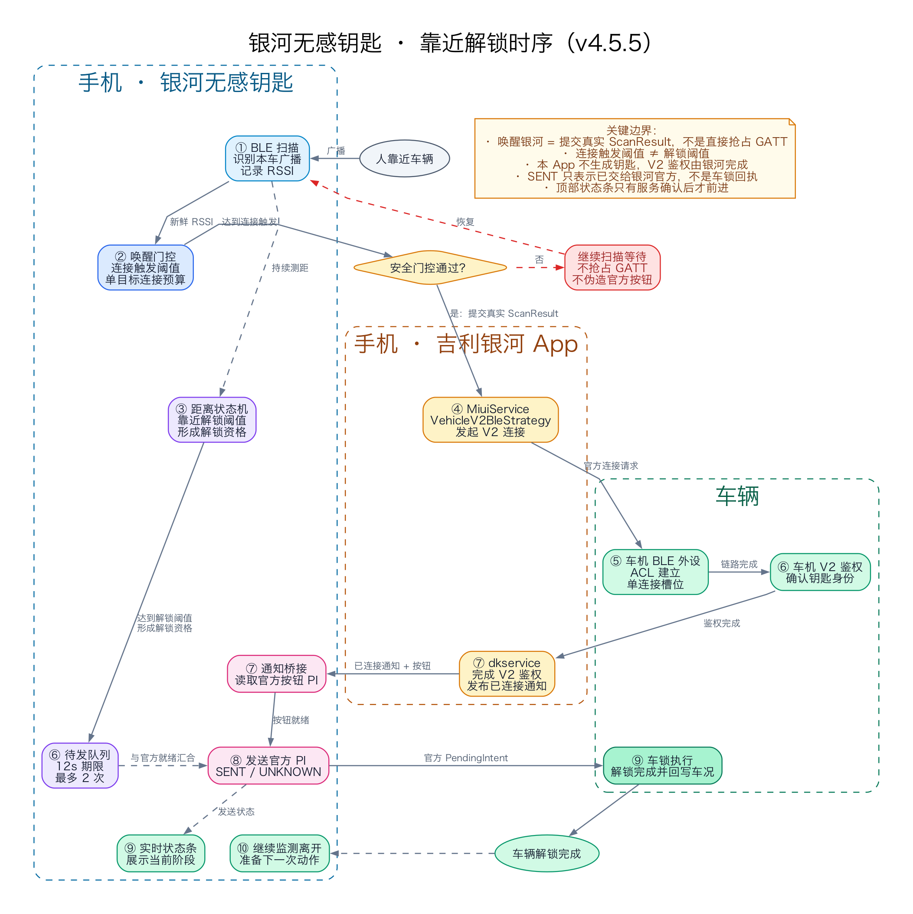
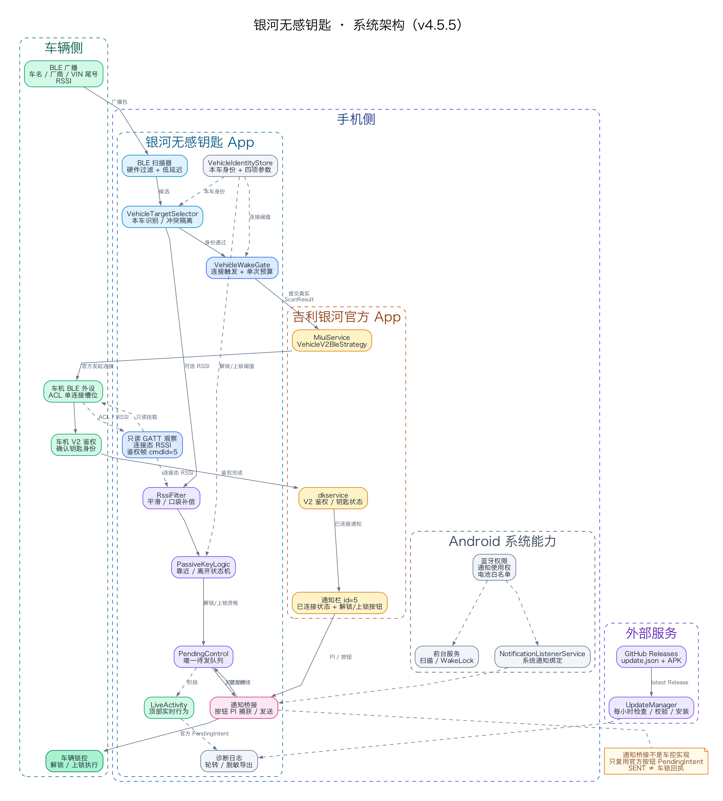

# 68. 靠近解锁时序图与系统架构图

本文对应代码版本 `v4.5.5-min / versionCode 505`，图示以当前代码为准：

- `VehicleWakeGate`：连接触发、单目标预算、ACL 保护；
- `PassiveKeyLogic`：靠近解锁、离开上锁、原生 PE 误锁纠偏；
- `PassiveKeyService`：唯一待发队列、官方就绪、GATT 测距；
- `KeyNotificationBridgeService`：官方通知按钮 PI 捕获与发送；
- `LiveActivity`：顶部跨页面实时阶段。

## 1. 靠近解锁时序图



源文件：[unlock_sequence.dot](diagrams/unlock_sequence.dot)。同时提供 `unlock_sequence.svg`。

阅读顺序：

```text
①  人靠近 → App 扫描到本车广播
②  RSSI 达到连接触发阈值 → VehicleWakeGate
③  提交真实 ScanResult → 银河 MiuiService
④  银河官方发起 V2 蓝牙连接
⑤  车机 BLE ACL 建立
⑥  车机与银河完成 V2 鉴权
⑦  银河通知栏发布“已连接”，按钮 PI 可用
⑧  本 App 的距离状态机与官方就绪汇合 → 待发队列
⑨  发送官方 PendingIntent → 车辆锁控
⑩  继续监测离开，顶部实时状态同步
```

注意：图中“连接触发阈值”和“靠近解锁阈值”是两个独立参数。连接阈值只负责更早把真实 `ScanResult` 交给银河；解锁阈值才决定何时形成解锁资格。两者不能合并成一个“距离阈值”。

## 2. 系统架构图



源文件：[current_architecture.dot](diagrams/current_architecture.dot)。同时提供 `current_architecture.svg`。

架构分层：

| 层 | 职责 |
| --- | --- |
| 车辆侧 | BLE 广播、单连接槽位、车机 V2 鉴权、车锁执行 |
| 本 App 扫描与识别 | 硬件过滤、扫描策略、本车身份、冲突隔离 |
| 本 App 决策 | `VehicleWakeGate`、`RssiFilter`、`PassiveKeyLogic`、`PendingControl` |
| 本 App 官方桥接 | `GeelyBridge` 提交真实 `ScanResult`；通知桥接复用官方按钮 PI；只读 GATT 观察连接态 RSSI |
| 吉利银河官方 App | `MiuiService` 发起连接，`dkservice` 完成 V2 鉴权并发布通知 |
| Android 系统 | 蓝牙权限、通知使用权、NotificationListenerService、前台服务、WakeLock |
| 外部服务 | GitHub Releases、`update.json`、APK 校验与安装 |

## 3. 关键边界

1. **唤醒银河不等于直接连接车机**。本 App 提交真实 `ScanResult`，由银河 `MiuiService` 发起官方连接；本 App 不直接抢占车机唯一 GATT 槽位。
2. **V2 鉴权由银河完成**。本 App 不生成钥匙、不伪造鉴权结果，只读取官方通知按钮和只读鉴权/车况事件。
3. **SENT 不等于车锁执行回执**。`pendingIntent.send()` 返回成功只表示已交给官方通知按钮；真实执行结果仍需观察车辆或日志。
4. **顶部实时状态不等于车辆回执**。`LiveActivity` 只反映服务已知阶段，不把“已发送”写成“已解锁”。

## 4. 旧图说明

`docs/diagrams/phone_key_workflow.*` 和 `our_app_rke_flow.*` 是 v2.x/v3.x 历史功能图，包含已删除的摇一摇、桌面组件、磁贴、语音、哨兵等入口，不能直接作为当前 v4.5.5 的实现说明。当前实现请看本文两张图。
